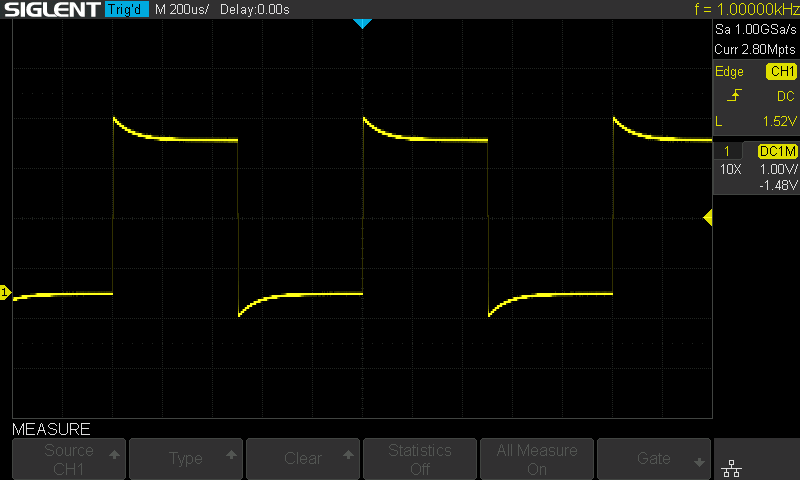
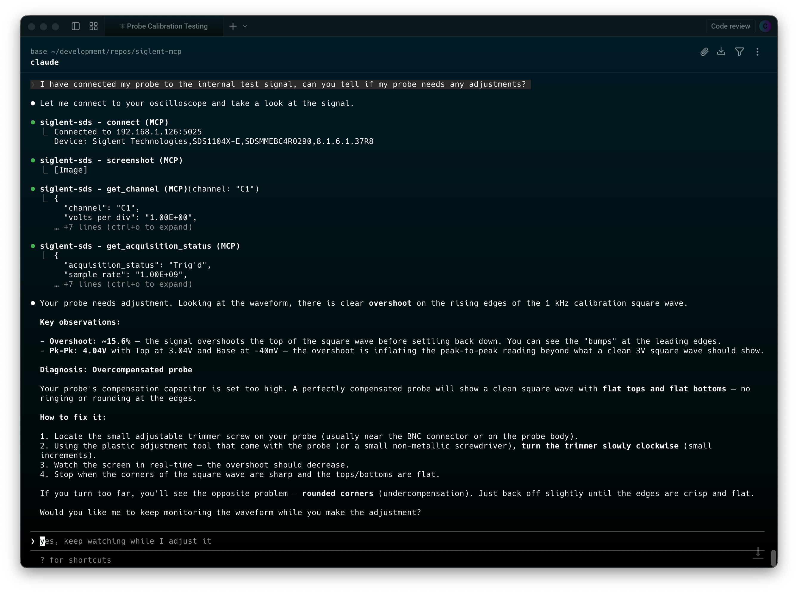

# siglent-sds-mcp

[](https://github.com/MagnusJohansson/siglent-sds-mcp/actions/workflows/ci.yml)
[](https://github.com/MagnusJohansson/siglent-sds-mcp/actions/workflows/codeql.yml)
[](https://scorecard.dev/viewer/?uri=github.com/MagnusJohansson/siglent-sds-mcp)
[](https://www.npmjs.com/package/siglent-sds-mcp)
[](LICENSE)

A [Model Context Protocol](https://modelcontextprotocol.io/) (MCP) server that lets AI assistants control Siglent oscilloscopes over your local network. Connect Claude to your bench and measure, capture, and configure your scope through natural language.

## Overview

This MCP server communicates with Siglent SDS oscilloscopes via SCPI commands over TCP sockets (port 5025). No VISA drivers or NI-MAX installation required — just a network connection to your scope.



*Oscilloscope display captured through the `screenshot` MCP tool.*



*Natural-language scope control and measurement workflow in the terminal.*

**Key features:**

- 12 tools covering channels, timebase, triggers, measurements, waveform capture, and screenshots
- Auto-connect on startup via environment variable
- Query queue serializes commands automatically — tools can safely run in parallel
- Waveform data returned as voltage/time arrays ready for analysis
- Screenshots captured and converted to PNG for inline display in Claude
- Raw SCPI escape hatch for any command not covered by the built-in tools

## Compatibility

| Status | Model |
|--------|-------|
| Tested | SDS1104X-E |
| Expected to work | SDS1000X-E series (SDS1202X-E, SDS1204X-E, etc.) |
| May work | Other Siglent SDS models with SCPI over TCP support |

The server uses standard SCPI commands from the [SDS1000X-E Programming Guide](https://siglentna.com/wp-content/uploads/dlm_uploads/2017/10/ProgrammingGuide_forSDS-1702.pdf). Other Siglent models that support the same command set over port 5025 should work with little or no modification.

## Quick Start

You need a Siglent oscilloscope accessible on your network (TCP port 5025). Pick one of the three options below and add the config to your `.mcp.json` (in your project directory, or `~/.claude/.mcp.json` for global access).

Replace `192.168.1.126` with your scope's IP address.

### Option A: Docker (recommended)

No Node.js installation required. Works on Linux, macOS, and Windows (via WSL2 or Docker Desktop).

```json
{
  "mcpServers": {
    "siglent-sds": {
      "type": "stdio",
      "command": "docker",
      "args": [
        "run", "--rm", "-i",
        "-e", "SIGLENT_IP=192.168.1.126",
        "ghcr.io/magnusjohansson/siglent-sds-mcp:latest"
      ]
    }
  }
}
```

### Option B: npx

Requires Node.js 20+. Downloads and runs the package automatically.

```json
{
  "mcpServers": {
    "siglent-sds": {
      "type": "stdio",
      "command": "npx",
      "args": ["-y", "siglent-sds-mcp"],
      "env": {
        "SIGLENT_IP": "192.168.1.126"
      }
    }
  }
}
```

### Option C: Clone and build

```bash
git clone https://github.com/magnusjohansson/siglent-sds-mcp.git
cd siglent-sds-mcp
npm install
npm run build
```

```json
{
  "mcpServers": {
    "siglent-sds": {
      "type": "stdio",
      "command": "node",
      "args": ["/path/to/siglent-sds-mcp/build/index.js"],
      "env": {
        "SIGLENT_IP": "192.168.1.126"
      }
    }
  }
}
```

Replace `/path/to/siglent-sds-mcp` with the actual path to your clone.

### Environment Variables

| Variable | Required | Default | Description |
|----------|----------|---------|-------------|
| `SIGLENT_IP` | No | — | Oscilloscope IP address for auto-connect on startup. Always allowed as a `connect` target. |
| `SIGLENT_PORT` | No | `5025` | TCP port (only change if your setup differs) |
| `SIGLENT_ALLOWED_HOSTS` | No | — | Comma-separated hosts `connect` may reach besides `SIGLENT_IP`. If neither is set, only private-LAN IP addresses are accepted. |
| `SIGLENT_ALLOW_RAW_SCPI` | No | `false` | Registers the raw `scpi_command` tool. Requires `SIGLENT_IP` or `SIGLENT_ALLOWED_HOSTS` naming specific hosts. |
| `SIGLENT_IDLE_TIMEOUT` | No | `0` (never) | Seconds of inactivity after which the scope connection is released (at most about 24 days). The next tool call reconnects automatically. |

Invalid values (e.g. a non-numeric port) stop the server at startup instead of being ignored.

### Auto-Connect Behavior

If `SIGLENT_IP` is set, the server attempts to connect to the scope immediately after starting. This runs in the background and does **not** block the MCP server — Claude can start using other tools right away. If the scope is offline or unreachable, the server logs a warning and you can connect manually later using the `connect` tool.

If `SIGLENT_IP` is not set, the server starts without a scope connection. Use the `connect` tool to connect when ready.

If the connection is closed (by the idle timeout, a reset after a timeout, or the scope restarting), the next tool call reconnects automatically to the last host, subject to the same host policy as `connect`. An explicit `disconnect` turns this off until `connect` is called again.

### One Client at a Time

The scope serves a single TCP client on port 5025. A second client can open the socket but gets no replies, so the server reports that the scope is probably in use by another program. If more than one MCP client uses the same scope, set `SIGLENT_IDLE_TIMEOUT` (e.g. `60`) in each so an idle server releases the scope for the other.

## Using with Other AI Clients

The Quick Start examples above use Claude Code's `.mcp.json` format, which includes a `"type": "stdio"` field. Other AI clients use the same JSON structure but **without** the `"type"` field and with different config file locations.

### Claude Desktop

Edit `claude_desktop_config.json`:

- **Windows:** `%APPDATA%\Claude\claude_desktop_config.json`
- **macOS:** `~/Library/Application Support/Claude/claude_desktop_config.json`

#### Docker

```json
{
  "mcpServers": {
    "siglent-sds": {
      "command": "docker",
      "args": [
        "run", "--rm", "-i",
        "-e", "SIGLENT_IP=192.168.1.126",
        "ghcr.io/magnusjohansson/siglent-sds-mcp:latest"
      ]
    }
  }
}
```

#### npx

```json
{
  "mcpServers": {
    "siglent-sds": {
      "command": "npx",
      "args": ["-y", "siglent-sds-mcp"],
      "env": {
        "SIGLENT_IP": "192.168.1.126"
      }
    }
  }
}
```

> **Note:** You must fully restart Claude Desktop after changing the config file.

### Cursor

Edit one of:

- **User-level:** `~/.cursor/mcp.json` (available across all projects)
- **Project-level:** `.cursor/mcp.json` (shared with your team via version control)

You can also add servers through the UI: **Settings > Cursor Settings > MCP > Add new global MCP server**.

#### Docker

```json
{
  "mcpServers": {
    "siglent-sds": {
      "command": "docker",
      "args": [
        "run", "--rm", "-i",
        "-e", "SIGLENT_IP=192.168.1.126",
        "ghcr.io/magnusjohansson/siglent-sds-mcp:latest"
      ]
    }
  }
}
```

#### npx

```json
{
  "mcpServers": {
    "siglent-sds": {
      "command": "npx",
      "args": ["-y", "siglent-sds-mcp"],
      "env": {
        "SIGLENT_IP": "192.168.1.126"
      }
    }
  }
}
```

### Windsurf

Edit `mcp_config.json`:

- **Windows:** `%USERPROFILE%\.codeium\windsurf\mcp_config.json`
- **macOS/Linux:** `~/.codeium/windsurf/mcp_config.json`

You can also configure servers through the UI: **Cascade panel > MCP icon > Manage MCP Servers > View raw config**.

#### Docker

```json
{
  "mcpServers": {
    "siglent-sds": {
      "command": "docker",
      "args": [
        "run", "--rm", "-i",
        "-e", "SIGLENT_IP=192.168.1.126",
        "ghcr.io/magnusjohansson/siglent-sds-mcp:latest"
      ]
    }
  }
}
```

#### npx

```json
{
  "mcpServers": {
    "siglent-sds": {
      "command": "npx",
      "args": ["-y", "siglent-sds-mcp"],
      "env": {
        "SIGLENT_IP": "192.168.1.126"
      }
    }
  }
}
```

### Google Antigravity

Configuration is managed through the IDE's UI:

1. Open the **Agent pane** on the right side of the workspace
2. Click the **`...`** button at the top
3. Select **MCP Servers**
4. Click **Manage MCP Servers**
5. Click **View raw config**
6. Add the configuration below and save

#### Docker

```json
{
  "mcpServers": {
    "siglent-sds": {
      "command": "docker",
      "args": [
        "run", "--rm", "-i",
        "-e", "SIGLENT_IP=192.168.1.126",
        "ghcr.io/magnusjohansson/siglent-sds-mcp:latest"
      ]
    }
  }
}
```

#### npx

```json
{
  "mcpServers": {
    "siglent-sds": {
      "command": "npx",
      "args": ["-y", "siglent-sds-mcp"],
      "env": {
        "SIGLENT_IP": "192.168.1.126"
      }
    }
  }
}
```

Replace `192.168.1.126` with your scope's IP address in all examples above.

### ChatGPT Desktop

ChatGPT Desktop only supports remote HTTPS MCP servers (called "connectors"), not local stdio servers. Since this MCP server uses stdio transport, it is not directly compatible with ChatGPT Desktop.

## Tools

12 tools across 6 categories by default, plus `scpi_command` when raw SCPI is enabled. See [docs/tools-reference.md](docs/tools-reference.md) for full parameter details.

| Category | Tool | Description |
|----------|------|-------------|
| Connection | `connect` | Connect to oscilloscope over TCP |
| | `disconnect` | Close the connection |
| | `identify` | Query device ID (manufacturer, model, serial, firmware) |
| Channel | `get_channel` | Read channel configuration (vdiv, offset, coupling, etc.) |
| | `configure_channel` | Set vdiv, offset, coupling, bandwidth limit, trace, probe |
| Acquisition | `get_acquisition_status` | Read timebase, sample rate, trigger settings |
| | `configure_acquisition` | Set timebase, trigger, run/stop/single |
| Measurement | `measure` | Read a measurement (frequency, Vpp, RMS, etc.) |
| | `measure_statistics` | Enable/read/reset measurement statistics |
| Waveform | `get_waveform` | Download voltage/time data arrays |
| | `screenshot` | Capture scope screen as PNG |
| SCPI | `scpi_query` | Send a SCPI query (queries only) |
| | `scpi_command` | Send a raw SCPI command. **Off by default**; see [Security](#security) |

## Security

Tool arguments come from a language model, which may have been steered by content it read (a datasheet, a web page, a previous tool result). The server therefore treats every argument as untrusted and enforces its checks in the connection layer, the single point every command passes through before it reaches the scope. See [docs/threat-model.md](docs/threat-model.md) for the full analysis.

- **One command per write.** Newlines, other control characters and `;` are rejected in every command and query, so a parameter can't smuggle in a second command.
- **`scpi_query` only sends queries:** a single header immediately followed by `?`. Parameters after `?` are only accepted for `PAVA?` (e.g. `C1:PAVA? FREQ`). `*` commands only as pure queries (`*IDN?`, `*OPC?`, ...); known action commands (`ASET?`, `ARM`, ...) and queries that clear a status register as they read it (`INR?`, `*ESR?`) are refused.
- **Strict formats** for every free-text parameter: voltages (`500mV`), times (`1US`).
- **`connect` is restricted** to `SIGLENT_IP`, `SIGLENT_ALLOWED_HOSTS`, or, if neither is set, private-LAN IP addresses, on the instrument port. Loopback, link-local (cloud metadata) and host names are refused. The same check applies to automatic reconnects.
- **Raw `scpi_command` is off by default.** Set `SIGLENT_ALLOW_RAW_SCPI=true` to enable it; it also requires named hosts (`*` is not accepted).
- **Replies stay matched to their queries.** After a timeout, or if a command unexpectedly produces output, the connection is reset so a late reply can't be read as the answer to the next query.

**What it does not protect against:**

- **Settings that can harm the scope or the circuit.** `configure_channel` can switch a channel to 50 Ω input coupling (`A50`/`D50`) on models that have it. A signal above the 50 Ω input's rating can then exceed what the input is specified for; check your scope's manual. With raw SCPI enabled, the model can change any setting.
- **Other clients on port 5025.** The instrument has no authentication: anyone with network access to it can control it directly, without this server. Network segmentation is the control for that.
- **Who is calling.** In stdio mode, whoever can start the server has full access.

## Example Conversations

### Read a channel configuration

> **You:** What's the current setup on channel 1?
>
> Claude calls `get_channel` with `channel: "C1"` and returns the volts/div, offset, coupling, and other settings.

### Measure a signal

> **You:** Measure the frequency and peak-to-peak voltage on channel 2.
>
> Claude calls `measure` twice — once with `parameter: "FREQ"` and once with `parameter: "PKPK"` on channel C2 — and reports both values.

### Capture and analyze a waveform

> **You:** Download the waveform from channel 1 and tell me what you see.
>
> Claude calls `get_waveform` on C1, receives voltage/time data, and analyzes the signal shape, frequency, amplitude, and any anomalies.

### Take a screenshot

> **You:** Show me what the scope screen looks like right now.
>
> Claude calls `screenshot`, receives a base64 BMP image, and displays it inline.

### Configure the scope for a specific measurement

> **You:** Set up channel 1 for a 3.3V logic signal — DC coupling, 1V/div, trigger on the rising edge at 1.6V.
>
> Claude calls `configure_channel` (setting vdiv, coupling) and `configure_acquisition` (setting trigger source, level, slope) in sequence.

## Architecture

```
Claude Code <-- stdio/JSON-RPC --> siglent-sds-mcp <-- TCP/SCPI --> Oscilloscope:5025
```

- **Transport:** MCP over stdio (JSON-RPC 2.0)
- **Protocol:** SCPI commands over raw TCP sockets, newline-terminated
- **Security checks:** Every command and query passes through the connection layer, which checks it before writing to the socket (see [Security](#security)).
- **Query Queue:** All SCPI queries are serialized through an internal queue. The oscilloscope processes one command at a time, so even when tools issue parallel requests (via `Promise.all`), the queue ensures they're sent sequentially.
- **Binary Block Parsing:** Waveform and screenshot data use IEEE 488.2 definite-length block format (`#9XXXXXXXXX` + data bytes + `\n\n`). The connection layer detects and parses these automatically.
- **Voltage Reconstruction:** Raw ADC codes are converted to voltages: `code * (vdiv / 25) - offset`, with two's complement handling for signed values.

## Development

```bash
npm run build       # Compile TypeScript
npm run watch       # Watch mode — recompile on changes
npm run dev         # Build and run
npm run inspector   # Launch with MCP Inspector for debugging
npm test            # Unit, integration and end-to-end security tests (SCPI simulator)
npm run hardware-check -- <scope-ip>   # Security checks against a real scope; restores the settings it changes
```

### Releasing

Publishing is triggered by **publishing a GitHub Release**, not by pushing a tag:

1. Bump `version` in `package.json` and `SERVER_VERSION` in `src/server.ts`, and add a `CHANGELOG.md` section. Merge to `master`.
2. Create a release (draft first) with tag `vX.Y.Z` on `master`, using the changelog section as the release notes.
3. Publish the release. This runs the npm publish (tests first, with provenance) and the GHCR image build.

The npm workflow fails if the tag doesn't match the `package.json` version, or if `repository.url` doesn't match the repository exactly. A pre-release publishes to the npm `next` dist-tag, and doesn't move the Docker `latest` tag. A draft release publishes nothing.

### Docker (local build)

Build the image locally:

```bash
docker build -t siglent-sds-mcp .
```

Then use the local image in your `.mcp.json`:

```json
{
  "mcpServers": {
    "siglent-sds": {
      "type": "stdio",
      "command": "docker",
      "args": [
        "run", "--rm", "-i",
        "-e", "SIGLENT_IP=192.168.1.126",
        "siglent-sds-mcp"
      ]
    }
  }
}
```

### Project Structure

```
src/
  index.ts              # Entry point, MCP server setup
  connection.ts         # TCP socket manager with query queue
  tools/
    connection.ts       # connect, disconnect, identify
    channel.ts          # get_channel, configure_channel
    acquisition.ts      # configure_acquisition, get_acquisition_status
    measure.ts          # measure, measure_statistics
    waveform.ts         # get_waveform, screenshot
    scpi.ts             # scpi_query, scpi_command
```

## Troubleshooting

### "Not connected to oscilloscope"

The scope isn't connected yet. Either set `SIGLENT_IP` in your `.mcp.json` env for auto-connect, or use the `connect` tool manually.

### Connection timeout

- Verify the scope's IP address (check the scope's Utility > Interface menu)
- Ensure port 5025 is accessible (try `telnet <scope-ip> 5025` from your machine)
- Check that no firewall is blocking the connection
- The scope only accepts one TCP connection at a time — close any other SCPI clients

### Query timeout

Some SCPI queries can take a few seconds, especially on slower scope models. The default timeout is 5 seconds. For `scpi_query`, you can increase the timeout with the `timeout_ms` parameter.

### Docker: can't reach the oscilloscope

By default, Docker containers can reach LAN devices via the bridge network (NAT). If the container can't connect to your scope:

- Verify the scope is reachable from your host: `telnet 192.168.1.126 5025`
- On Linux, try adding `--network host` to the Docker args:
  ```json
  "args": ["run", "--rm", "-i", "--network", "host", "-e", "SIGLENT_IP=192.168.1.126", "ghcr.io/magnusjohansson/siglent-sds-mcp:latest"]
  ```
  Note: `--network host` does not work on macOS or Windows Docker Desktop.

### Docker: wrong architecture / exec format error

The published image supports `linux/amd64` and `linux/arm64`. Docker should pull the correct one automatically. If you see an exec format error, pull explicitly:

```bash
docker pull --platform linux/amd64 ghcr.io/magnusjohansson/siglent-sds-mcp:latest
```

### "CHDR" appears in responses

This shouldn't happen — the server sets `CHDR OFF` on connect. If you see command headers in responses, try disconnecting and reconnecting.

## License

MIT — see [LICENSE](LICENSE) for details.
